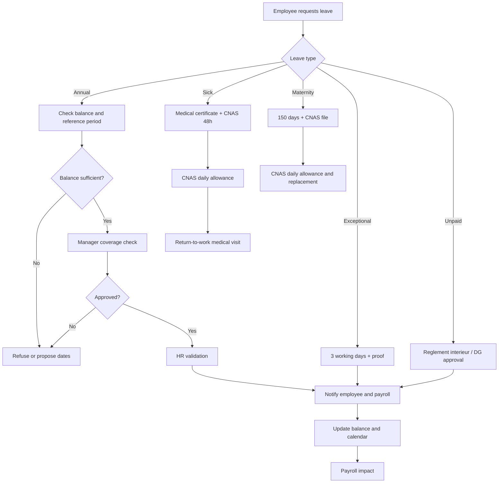
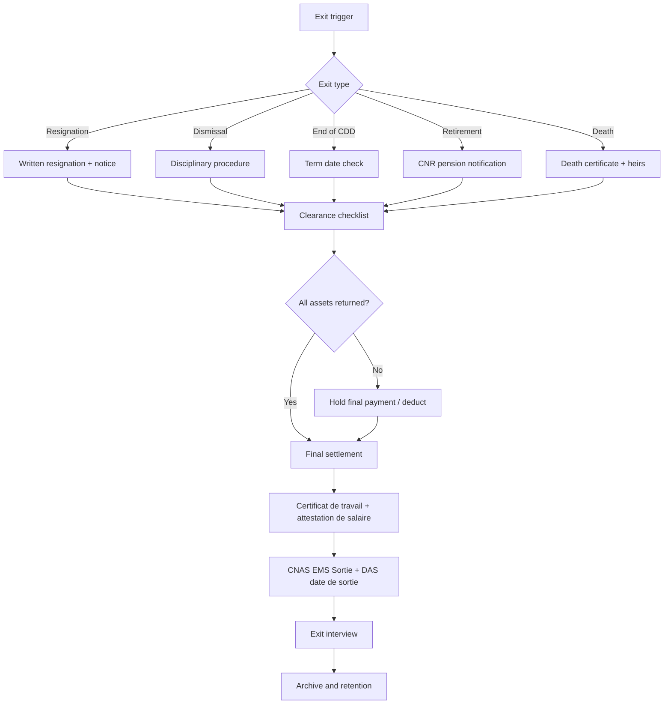

# 03 — How HR Actually Runs in Algeria: Process Maps, Data and States (2026)

**Product input for the SIRH / HRIS spec.** This document describes the operating reality of HR in Algerian employers — not an idealised model — so that entities, fields, state machines, approvals and reports can be specified correctly.

---

## Scope

- **Legal core:** private-sector employment under **loi n° 90-11 du 21 avril 1990** (relations de travail), its modifying texts (loi 91-29, ordonnance 96-21, ordonnance 97-03), **loi 83-14** (social-security obligations), **loi 83-11** as modified by **loi 25-08** (maternity), **loi 88-07** (occupational health and safety), **loi 04-19** (placement / ANEM), **loi 18-07** (personal data).
- **Scope:** **private sector only** (loi 90-11). Public-sector statutes (ordonnance 06-03, concours, titularisation, postes budgétaires) are out of scope.
- **Company size:** from owner-managed SMEs (no dedicated HR, external accountant) to large groups with a DRH, a paie team and multiple establishments.
- **Timeframe:** practice observed / documented up to **7 November 2026**. Rules change with the annual finance law and social-security decrees; every duration below is sourced.
- **Out of scope:** detailed payroll calculation (IRG barème, CNAS contribution base), collective-bargaining content by sector, and expatriate work permits.

---

## Legend

| Tag | Meaning |
|---|---|
| **`[LOI]`** | Required by an Algerian legal or regulatory text. The source is cited. |
| **`[PRATIQUE]`** | Common company practice. Not a legal obligation; must be configurable. |
| **`[LOI + PRATIQUE]`** | The law sets a floor or a deadline; practice adds the workflow around it. |
| **`UNVERIFIED`** | Not confirmed by an official text read for this document. Validate locally before hard-coding. |
| **`SME` / `GE`** | Difference between small/medium employers and large enterprises/groups. |
| **French / Arabic terms** | Retained in **bold** because they are the words used in Algerian HR, payroll and inspections (e.g. **registre d'employeur**, **attestation de travail**, **visite médicale**, **DAS**). |

> **Reading rule:** a duration is either `[LOI]` with a text, or `UNVERIFIED`. Where local practice commonly differs (e.g. notice periods), the document says so rather than inventing a number.

---

## 0. Hire-to-retire at a glance

```mermaid
flowchart LR
  subgraph REC[Recruitment]
    R1[Headcount request] --> R2[Requisition and budget approval]
    R2 --> R3[ANEM notification and sourcing]
    R3 --> R4[Screening and interviews]
    R4 --> R5[Offer]
    R5 --> R6[Pre-employment medical]
    R6 --> R7[Contract signature]
  end

  subgraph ONB[Onboarding]
    R7 --> O1[Employee file]
    O1 --> O2[CNAS affiliation D+10]
    O2 --> O3[Registre d'employeur / registre du personnel]
    O3 --> O4[Medical visit and security induction]
    O4 --> O5[IT and asset provisioning]
    O5 --> O6[Payroll set-up]
    O6 --> O7[Probation reviews]
    O7 -->|confirmed| O8[Confirmation letter]
  end

  subgraph LIFE[Employee life]
    O8 --> L1[Time and attendance]
    L1 --> L2[Leave and absences]
    L2 --> L3[Transfer / promotion / salary review]
    L3 --> L4[Training]
    L4 --> L5[Disciplinary or long absence if any]
    L5 --> L6[Return to work]
    L6 --> L1
  end

  subgraph OUT[Offboarding]
    L3 --> X1[Resignation / dismissal / CDD end / retirement / death]
    L2 --> X1
    X1 --> X2[Clearance checklist]
    X2 --> X3[Final settlement]
    X3 --> X4[Certificat de travail and attestation de salaire]
    X4 --> X5[CNAS exit and DAS date de sortie]
    X5 --> X6[Archive and exit interview]
  end
```



---

## 1. Recruitment

### 1.1 Legal frame

| Point | Rule | Tag / source |
|---|---|---|
| Contract form | Written or oral contract is valid, but without a written contract the relationship is **presumed indefinite (CDI)**. | `[LOI]` loi 90-11 art. 8, 11 |
| CDI is the rule | CDD is allowed only in five closed cases: non-renewable works/services contract, replacement of an absent employee, periodic/discontinuous work, temporary workload increase, seasonal or inherently temporary activity. | `[LOI]` loi 90-11 art. 12, ordonnance 96-21 |
| CDD control | The labour inspector verifies both the **motive** and the **duration**. A CDD outside art. 12 is requalified as a CDI. | `[LOI]` loi 90-11 art. 12 bis, 14 |
| Minimum age | 16 years (apprenticeship excepted). | `[LOI]` loi 90-11 art. 15 |
| ANEM | Employer must notify vacant posts to the local **ANEM** agency (or **Wassit** platform / an approved private placement body), leave the legal response delay, then may recruit directly; it must inform ANEM of hires made, including hires not presented by ANEM. | `[LOI]` loi 04-19 art. 18–19 |
| ANEM delay | ANEM has **5 working days** to propose registered candidates. Direct recruitment is possible after that delay. | `[LOI]` loi 04-19; practice source Chghol 2026 |
| Offer | No legal obligation to issue a separate written offer; the contract is the binding document. A written offer is market practice. | `[PRATIQUE]` |

### 1.2 Process map

| # | Step | Actor | Output / record | Tag |
|---|---|---|---|---|
| 1 | **Expression du besoin** — new role, replacement or temporary surge | Chef de département / chef d'équipe | Draft job description, grade, location, budget | `[PRATIQUE]` |
| 2 | **Réquisition de poste** — headcount and budget check | DRH + Contrôle de gestion + DG (or DG only in SME) | Signed requisition; headcount opened | `[PRATIQUE]` |
| 3 | **Validation du poste** — grade, salary range, contract type | DG / DRH | Approved requisition; salary band | `[PRATIQUE]` |
| 4 | **Déclaration ANEM** — vacancy notified | HR / owner | ANEM notification receipt; 5-working-day clock | `[LOI]` loi 04-19 |
| 5 | **Sourcing** — job board, LinkedIn, Facebook, referrals, schools, cabinet | HR + manager | Candidate pipeline | `[PRATIQUE]` |
| 6 | **Présélection** — CV screening, phone screen, knock-out questions | HR | Shortlist (5–8) | `[PRATIQUE]` |
| 7 | **Entretiens** — 1–2 rounds + practical case | Manager + HR (+ peer) | Interview scorecard | `[PRATIQUE]` |
| 8 | **Vérifications** — diplomas, references, casier judiciaire where justified | HR | Verification note | `[PRATIQUE]` |
| 9 | **Offre** — written offer, salary, start date, probation | HR / DG | Signed or accepted offer | `[PRATIQUE]` |
| 10 | **Visite médicale d'embauche** — aptitude before taking the post | Médecin du travail | Aptitude certificate (apte / apte avec restrictions / inapte) | `[LOI]` loi 88-07 |
| 11 | **Contrat** — CDI/CDD, bilingual FR/AR in practice | HR + employee | Signed contract, 2 originals | `[LOI]` written for CDD; `[PRATIQUE]` written for CDI |
| 12 | **Déclaration du recrutement à l'ANEM** | HR | ANEM hire notification | `[LOI]` loi 04-19 art. 19 |
| 13 | **Affiliation CNAS** | HR / paie | CNAS affiliation request within 10 days | `[LOI]` loi 83-14 art. 10 |

### 1.3 Sourcing channels — what actually works

| Channel | Best for | Reality / caveat | Tag |
|---|---|---|---|
| **ANEM** (local agency, **Wassit**) | Blue-collar, agents, first jobs, assisted contracts | Free, legally mandatory notification; candidate quality and delay vary by agency. | `[LOI + PRATIQUE]` |
| **Emploitic / Emploi.dz** | Cadres, technicians, qualified employees | Emploitic is the historical market leader; job boards produce volume, require strong screening. | `[PRATIQUE]` |
| **LinkedIn** | Cadres, rare tech/commercial profiles | Effective for senior and specialist roles; less useful for operational staff. | `[PRATIQUE]` |
| **Facebook groups / pages** | Field sales, retail, drivers, administrative staff | High volume, low qualification; widely used in Algeria. | `[PRATIQUE]` |
| **Cooptation / referrals** | All levels | Fast, cheap, culturally strong; risk of clannish hiring. A modest **prime de cooptation** is common. | `[PRATIQUE]` |
| **Schools, universities, CFPA** | Interns, apprentices, young graduates | Forums, PFE (final-year projects), apprenticeship contracts. | `[PRATIQUE]` |
| **Cabinets de recrutement** | Executive search, volume hiring | Expensive; verify the **agrément** (placement licence) and ANEM convention. | `[PRATIQUE]` |
| **Internal mobility** | Existing staff | Cheaper and faster; needs a transparent **mobilité interne** rule. | `[PRATIQUE]` |

### 1.4 ANEM obligations in detail

| Obligation | When | Evidence to keep | Tag |
|---|---|---|---|
| Notify the vacant post | Before recruitment | ANEM/Wassit notification, job description, salary range | `[LOI]` loi 04-19 art. 18 |
| Wait for candidate proposals | 5 working days | Timestamp / ANEM acknowledgement | `[LOI]` |
| Recruit directly if no suitable candidate | After the delay | Written rationale | `[LOI]` |
| Inform ANEM of the hire | After hiring, including direct hires | Hire notification; **bulletin de placement** if ANEM-assisted | `[LOI]` loi 04-19 art. 19 |
| Keep proof for CNAS abatements | At hiring | **Bulletin de placement** | `[PRATIQUE]` / incentive scheme |

> **SIRH implication:** the requisition must carry an `anem_notified_at` timestamp and an `anem_response_due_at = +5 working days` (working days = Sunday–Thursday, public holidays excluded). A blocking rule prevents “direct hire” before that date, or requires an override reason.

### 1.5 Public-sector recruitment

Out of scope: this pack is private sector only. Concours, postes budgétaires and titularisation are not covered.

### 1.6 Pre-employment medical and background checks

| Check | Rule / practice | Tag |
|---|---|---|
| **Visite médicale d'embauche** | Mandatory for every worker/apprentice; employer organises and pays; the occupational physician assesses fitness for the post **before insertion into the workplace**. | `[LOI]` loi 88-07 art. 12–13; Legal Doctrine |
| Periodic visit | At least **once a year** for all workers; special visits for specific risks. | `[LOI]` loi 88-07 art. 17 |
| Fitness decision | Only the occupational physician decides; HR stores the **certificate**, not the medical file. | `[LOI + PRATIQUE]` |
| Diploma verification | Original or certified copy; contact the school/university if doubt. | `[PRATIQUE]` |
| References | Call previous employers; documented. | `[PRATIQUE]` |
| **Casier judiciaire** | Common for finance, security, driving, childcare, cash handling; not a general statutory requirement. | `[PRATIQUE]` |
| CNAS history | Sometimes requested to verify declared experience; not a general legal right. | `[PRATIQUE]` |
| Health / pregnancy / family status | Must not be used as a selection criterion; health data belongs to the occupational physician. | `[LOI]` non-discrimination art. 17; law 18-07 |

### 1.7 Candidate data retention

- **Law 18-07** requires a **prior declaration** to the **ANPDP** for any personal-data processing, including recruitment files; the declaration must state the **retention period**, purposes, recipients and security measures. `[LOI]` law 18-07 art. 12–14; ProfitPilot 2026.
- There is **no single statutory duration** for unsuccessful candidate files. Common practice is **6–24 months** (to defend a recruitment dispute and to re-contact), then deletion/anonymisation. `UNVERIFIED` — validate with the ANPDP declaration and legal counsel.
- Successful candidates' data moves into the **dossier salarié** and is kept for the employment relationship + legal retention.
- **Biometric data** collected at clock-in must be declared, employees informed, used only for the declared purpose, and **destroyed at the end of the employment relationship**. `[LOI]` law 18-07; ANPDP deliberation of 6 May 2026.

### 1.8 Data model — recruitment

| Entity | Key fields |
|---|---|
| `JobRequisition` | id, title, department, site, grade, headcount, contract_type, budgeted_salary_min/max, reason (new/replacement), requester, approver, status, anem_notified_at, anem_due_at |
| `Vacancy` | requisition_id, channel, published_at, closing_at, location, salary_display, status |
| `Candidate` | id, first/last name (AR/FR), NIN, phone, email, address, source, CV, consent, retention_until, status |
| `Application` | candidate_id, vacancy_id, stage, score, recruiter, rejection_reason, applied_at |
| `Interview` | application_id, round, interviewer, date, scorecard, recommendation |
| `Offer` | application_id, salary_base, allowances, start_date, probation_months, contract_type, status, accepted_at |
| `MedicalVisit` | candidate_id, visit_type (embauche/périodique/reprise), date, physician, fitness (apte/apte avec restrictions/inapte), certificate_ref |
| `BackgroundCheck` | candidate_id, type, provider, result, document_ref, completed_at |

**Requisition states:** `DRAFT → PENDING_BUDGET → APPROVED → PUBLISHED → SOURCING → SHORTLIST → INTERVIEWS → OFFER → FILLED / CANCELLED / ON_HOLD`.

**Application states:** `NEW → SCREENING → PHONE_SCREEN → INTERVIEW_1 → INTERVIEW_2 → OFFER → PRE_EMPLOYMENT → HIRED / REJECTED / WITHDRAWN / TALENT_POOL`.

---

## 2. Onboarding

### 2.1 The first 30 days — legal deadlines vs good practice

| Moment | Legal obligation | Common good practice | Tag |
|---|---|---|---|
| **Before day 1** | — | Confirm start date, place, manager; prepare desk, IT, PPE; assign a **parrain** (buddy); send welcome pack | `[PRATIQUE]` |
| **Day 1** | Written contract (mandatory for CDD); **règlement intérieur** handed over if ≥20 employees | Welcome by the manager, site tour, team introduction, first simple task | `[LOI]` art. 12, 75; `[PRATIQUE]` |
| **Week 1** | Information on occupational risks and safety rules | Daily 10-minute check-in; share reference documents | `[LOI]` loi 88-07; `[PRATIQUE]` |
| **By day 10** | **CNAS affiliation** and declaration; entry in the **registre du personnel**; ANEM hire notification | Give the employee a copy of the affiliation certificate | `[LOI]` loi 83-14 art. 10; décret 96-98; loi 04-19 |
| **Weeks 1–4** | **Visite médicale d'embauche** by the occupational physician | Written 30-day objectives; weekly review; first autonomous task | `[LOI]` loi 88-07; `[PRATIQUE]` |
| **End of month 1** | First payslip with CNAS and IRG deductions | Signed 30-day review; probation plan | `[LOI]`; `[PRATIQUE]` |

> **SME reality:** the owner or the accountant does the CNAS declaration; there is often no HRIS and no formal 30-day review. **GE reality:** a shared-service onboarding team, a checklist in the SIRH, IT tickets, and a 90-day probation programme.

### 2.2 Employee file — documents to collect

| Document | Mandatory / practice | Notes |
|---|---|---|
| Signed contract (CDI/CDD) + amendments | `[LOI]` / `[PRATIQUE]` | CDD must state motive and duration; bilingual FR/AR common |
| National ID / **NIN** | `[LOI]` for CNAS/DAS | NIN is increasingly mandatory in CNAS declarations (2026) |
| Birth certificate / **acte de naissance** | `[LOI]` for CNAS file | Recent copy |
| Family record / **fiche familiale** | `[LOI]` for CNAS dependants | If married / dependants |
| **NAS** / CNAS number | `[LOI]` | Or affiliation request in progress |
| Diplomas and certificates | `[PRATIQUE]` | Certified copies; verify originals |
| CV and application | `[PRATIQUE]` | Keep with recruitment file |
| **Casier judiciaire** | `[PRATIQUE]` | Recent extract |
| Service-national proof | `[PRATIQUE]` | Men |
| **Certificat médical d'aptitude** | `[LOI]` | Issued by the occupational physician |
| Bank details (**RIB**) | `[PRATIQUE]` | For salary transfer |
| Photos | `[PRATIQUE]` | Badge, file |
| Signed job description | `[PRATIQUE]` | Useful for probation and disputes |
| **Règlement intérieur** acknowledgement | `[LOI]` if ≥20 | Signed receipt |
| IT / confidentiality charter | `[PRATIQUE]` | Access and data rules |
| Emergency contact | `[PRATIQUE]` | |
| Asset receipt | `[PRATIQUE]` | Laptop, phone, vehicle, tools, PPE |

### 2.3 Registre d'employeur vs registre du personnel

These are often confused; the SIRH should support both.

| Register | Legal basis | Content | Format |
|---|---|---|---|
| **Registre de l'employeur** | Décret exécutif n° 96-98 (livres et registres obligatoires) — confirm the exact model with the labour inspectorate | Civil status, function, salary of each employee; all mentions needed for labour inspection | Coté et paraphé (numbered and initialled), or digital if printable and complete |
| **Registre du personnel** | Loi 90-11 art. 16 | Name, NIN, birth date/place, post and category, hire date, contract type, base and last salary, annual leave taken, departure date and reason, CNAS number | Paper or digital; kept at the disposal of the labour inspector |
| **Registre des congés payés** | Practice / inspection | Leave dates, durations, balances | Paper or digital |
| **Registre d'hygiène et sécurité** | Loi 88-07 / practice | Incidents, training, equipment, safety rounds | Paper or digital |
| **Registre des accidents du travail** | Practice / CNAS | Declarations and medical follow-up | Paper or digital |

**Retention:** commonly **10 years after the employee's departure** for the personnel register and payroll records. `UNVERIFIED` as a single statutory duration; treat as a configurable retention rule and align with the ANPDP declaration.

### 2.4 CNAS affiliation and payroll set-up

| Step | Detail | Deadline | Tag |
|---|---|---|---|
| Employer registration | Employer already has a CNAS **numéro employeur**; new employer declares activity within 10 days of starting | 10 days | `[LOI]` loi 83-14 art. 6 |
| Employee affiliation | Request for each new employee | **10 days after hiring** | `[LOI]` loi 83-14 art. 10 |
| Affiliation file | Contract copy, ID, birth certificate, family record, photos, CNAS form | — | `[LOI + PRATIQUE]` |
| Payroll master data | Base salary, allowances, bank, cost centre, IRG parameters, CNAS number | Before first pay | `[PRATIQUE]` |
| First payslip | CNAS 9% employee + IRG withheld; employer 25% + 0.5% social works | First pay cycle | `[LOI]` décret 94-187 as modified |
| DAS — **Déclaration Annuelle des Salaires** | Annual salary declaration per employee, including entry/exit dates | 30 days after year-end (CNAS communicated **31 January 2026**) | `[LOI]` loi 83-14; Ratib 2026 |

### 2.5 Medical visit, IT and assets

| Item | Rule / practice | Tag |
|---|---|---|
| **Visite médicale d'embauche** | Before taking the post; employer pays; physician decides fitness | `[LOI]` loi 88-07 |
| Safety induction | Information on risks, PPE, emergency procedures; mandatory in BTP, industry, South bases | `[LOI]` loi 88-07 |
| IT account | Email, SSO, HRIS, payroll, badge; least-privilege role | `[PRATIQUE]` |
| Asset register | Asset tag, serial, receipt, return date; laptop, phone, vehicle, tools, PPE | `[PRATIQUE]` |
| Access card / biometric enrolment | Enrolment after hiring; information notice; ANPDP declaration | `[LOI + PRATIQUE]` |
| Uniform / PPE | Sizes, issue, acknowledgement | `[PRATIQUE]` |

### 2.6 Probation tracking and confirmation

| Point | Rule | Tag |
|---|---|---|
| Maximum duration | **6 months** general; **12 months** for a post of **haute qualification**. The contract or collective agreement sets the actual duration within these ceilings. | `[LOI]` loi 90-11 art. 18 |
| Renewal | The law does not provide for renewal; if the collective agreement allows it, the total must stay within the ceiling. | `[LOI + PRATIQUE]` |
| Rights during probation | Same rights and obligations as other employees; CNAS affiliation and salary apply; probation counts in seniority if confirmed. | `[LOI]` art. 19 |
| Termination | Either party may terminate at any time **without notice or indemnity**; not a dismissal; accrued salary and leave remain due. | `[LOI]` art. 20 |
| Discrimination | Termination cannot be based on a discriminatory motive. | `[LOI]` art. 17 |
| Confirmation | Written confirmation letter, usually after a 30/60/90-day review. | `[PRATIQUE]` |

**Probation states:** `SCHEDULED → ACTIVE → REVIEW_30 → REVIEW_60 → REVIEW_90 → CONFIRMED / EXTENDED (if allowed) / TERMINATED / RESIGNED`.

> **SIRH implication:** store `probation_start`, `probation_end`, `probation_max_end`, `review_dates`, `confirmation_letter_ref`. Alert the manager at D-30 / D-15 / D-7. Block a “confirmation” beyond the legal ceiling unless an override with reason is recorded.

---

## 3. Time and attendance

> Shift systems, rotation limits and shift/night premiums: see `07-contrats-et-rotation.md` Part B.

### 3.1 Legal frame

| Point | Rule | Tag / source |
|---|---|---|
| Weekly duration | **40 hours** in normal conditions, spread over at least **5 working days**. | `[LOI]` ordonnance 97-03 art. 2 |
| Daily amplitude | Effective work cannot exceed **12 hours** per day. | `[LOI]` ordonnance 97-03 art. 7 |
| Continuous shift | A break of no more than **1 hour**, of which **30 minutes** count as work. | `[LOI]` ordonnance 97-03 art. 6 |
| Weekly rest | One full day per week; the normal rest day is **Friday**. | `[LOI]` loi 90-11 art. 33 |
| Night work | Work between **21:00 and 05:00**. | `[LOI]` loi 90-11 art. 27 |
| Overtime | Must respond to an absolute service need and remain exceptional; cannot exceed **20%** of legal duration. | `[LOI]` loi 90-11 art. 31 |
| Overtime premium | At least **+50%** of the normal hourly wage; a higher rate can only come from a collective agreement. | `[LOI]` loi 90-11 art. 32 |
| Part-time | Indefinite contract with average hours below legal duration; cannot be less than **half** the legal duration. | `[LOI]` loi 90-11 art. 13 |
| **Règlement intérieur** | Mandatory at **20 employees**; sets work organisation, hygiene, safety and discipline. Filed with the labour inspectorate within 8 days. | `[LOI]` loi 90-11 art. 75–79 |

### 3.2 Typical calendars

| Environment | Working week | Weekend | Notes | Tag |
|---|---|---|---|---|
| **Public administration** | Sunday–Thursday | Friday–Saturday | Official; Ramadan hours set centrally | `[LOI + PRATIQUE]` |
| **Private office / services** | Sunday–Thursday | Friday–Saturday | Most common white-collar pattern | `[PRATIQUE]` |
| **Private with Saturday** | Sunday–Thursday + Saturday morning, or Saturday–Thursday | Friday only / Friday + Sunday | Common in retail, clinics, restaurants, some industry | `[PRATIQUE]` |
| **Industry / BTP** | Sunday–Thursday or shift rotation | Friday | 3×8, 2×8, continuous process; site-specific | `[PRATIQUE]` |
| **Retail / hospitality** | 6 days, rotating rest day | Friday or sliding | Friday rest is the legal default; sector practice varies | `[PRATIQUE]` |
| **Ramadan — private sector** | Often reduced by 1–2 hours/day | Unchanged | No general legal obligation to reduce; company policy / collective agreement | `[PRATIQUE]` |

> **SIRH implication:** the calendar must be **per establishment**, not per company, and must support: fixed weekly rest day, rotating shifts, Ramadan period with a separate shift template, public-holiday calendar (fixed + lunar, dates confirmed yearly), and a “Friday is the legal default rest day” flag.

### 3.3 Clock-in methods

| Method | Prevalence | Pros / cons | Tag |
|---|---|---|---|
| **Biometric fingerprint** | Very common in Algerian companies, public and private | Fast, deters “buddy punching”; requires ANPDP declaration, information notice, security, destruction at exit | `[PRATIQUE]`; `[LOI]` law 18-07 |
| Facial recognition | Growing | Contactless; same data-protection duties | `[PRATIQUE]` |
| Badge / RFID | Common in industry and large sites | Cheap; shared badges are a risk | `[PRATIQUE]` |
| Mobile app / geolocation | Field staff, sales, remote | Geolocation needs a strong legal basis and information; not for permanent surveillance | `[PRATIQUE]`; `[LOI]` law 18-07 |
| Paper / Excel | SMEs | Simple; weak evidence; payroll re-keying | `[PRATIQUE]` |
| Manual supervisor entry | Sites without devices | Works offline; needs approval and audit | `[PRATIQUE]` |

**ANPDP position (6 May 2026):** biometric clock-in is **not** subject to prior explicit consent because it falls within HR organisation and internal discipline, **but** the employer must:
1. make a **prior declaration** to the ANPDP;
2. inform employees of the collection, purpose and retention;
3. guarantee security and confidentiality;
4. not use the data for another purpose;
5. **destroy the data at the end of the employment relationship**.

Source: ANPDP deliberation, reported by Algérie Eco, 7 May 2026.

### 3.4 Overtime process

| Step | Actor | Rule / practice | Tag |
|---|---|---|---|
| 1. Request | Chef d'équipe / employee | Written or SIRH request, reason, hours, cost centre | `[PRATIQUE]` |
| 2. Approval | Chef de département / DRH | Prior approval; exceptional need | `[PRATIQUE]` |
| 3. Cap check | SIRH | 20% of legal duration; monthly and annual counters | `[LOI]` art. 31 |
| 4. Pay or recover | Paie | +50% minimum; collective agreement may be higher | `[LOI]` art. 32 |
| 5. Record | Paie / HR | Overtime register, payslip line, audit trail | `[PRATIQUE]` |

> **Practice note:** “récupération” (time off in lieu) is common but is **not** a statutory substitute for the +50% premium unless the collective agreement provides it. Model both `PAID` and `RECOVERED` with a policy switch.

### 3.5 Absence justification

| Absence type | Justification | Deadline / practice | Tag |
|---|---|---|---|
| Sick leave | Medical certificate + CNAS declaration | Employee informs employer immediately; CNAS declaration within **48 hours** via **El Hana** | `[LOI]` CNAS; `[PRATIQUE]` |
| Exceptional leave | Marriage, birth, death, circumcision, pilgrimage | Prior notice where possible; proof after for birth/death | `[LOI]` art. 54 |
| Annual leave | Approved request | Before absence | `[LOI + PRATIQUE]` |
| Unjustified absence | None | Disciplinary procedure; **abandon de poste** is a serious fault | `[LOI]` art. 73; `[PRATIQUE]` |
| Late arrival | None / badge | Grace period set by **règlement intérieur** | `[PRATIQUE]` |

### 3.6 Employee representation

| Body | Threshold | Role | Tag |
|---|---|---|---|
| **Délégués du personnel** | At least **20 workers** at a distinct workplace | Represent employees; elect the **comité de participation** | `[LOI]` loi 90-11 art. 91–99 |
| **Comité de participation** | At the employer's head office, from elected delegates | Receives quarterly information (headcount, absenteeism, accidents, discipline); consulted on work organisation, hours, training plan, restructuring, internal rules, contract models; manages social works | `[LOI]` loi 90-11 art. 94, 102–104 |
| Union delegates | Where a union is representative | Collective bargaining, employee defence | `[LOI]` |

> **SIRH implication:** the comité de participation is not an approval step for every leave request, but it **must be consulted** on the annual leave plan, work organisation, training plan and internal rules. Keep a `consultation` record with date, members, opinion, and the 15-day opinion deadline.

### 3.7 Data model — time

| Entity | Key fields |
|---|---|
| `WorkCalendar` | id, site_id, name, week_pattern, rest_days, ramadan_pattern, holiday_calendar_id, effective_from/to |
| `Shift` | id, site_id, name, start, end, break_minutes, night_flag, tolerance_in/out |
| `Roster` | employee_id, shift_id, date, status (planned/confirmed/swapped), published_at |
| `TimePunch` | employee_id, timestamp, device_id, method (biometric/badge/mobile/manual), in/out, source_hash |
| `TimeEvent` | employee_id, date, type (late/early/absence/overtime/rest_day_work), minutes, validated_by |
| `OvertimeRequest` | employee_id, date, minutes, reason, cost_centre, status, approver, premium_rate, pay_mode |
| `Absence` | employee_id, type, start, end, days, justification_ref, status, impacts_leave_balance |

**Time-event states:** `RAW → CALCULATED → SUPERVISOR_REVIEW → APPROVED → PAYROLL_LOCKED → EXPORTED`.

---

## 4. Leave management

### 4.1 Leave types

| Type | Entitlement / rule | Paid by | Tag |
|---|---|---|---|
| **Congé annuel payé** | 2.5 days per month of work; maximum **30 calendar days** per year of work; reference period **1 July – 30 June**; pro-rata for newcomers. | Employer | `[LOI]` loi 90-11 art. 39–41 |
| **Congé supplémentaire du Sud** | At least **+10 days** per year in the southern wilayas, under collective-agreement terms. | Employer | `[LOI]` art. 42 |
| **Congé maladie** | CNAS daily allowance: **50%** of daily wage for days 1–15, **100%** from day 16; **100%** from day 1 for hospitalisation or long-term illness; maximum **3 years**. | CNAS | `[LOI]` loi 83-11; Cleiss 2024 |
| **Congé de maternité** | **150 consecutive days** at **100%**, from up to **42 days before** the presumed delivery; first extension of **+50 days**, then a second extension up to **165 days** for the child's health (source wording; confirm whether the 165 days are additional or total). | CNAS | `[LOI]` loi 25-08 of 19 July 2025 |
| **Congés exceptionnels** | **3 working days** paid per event: employee's marriage, birth of a child, marriage of a descendant, death of ascendant/descendant/first-degree collateral/spouse, circumcision of a child. | Employer | `[LOI]` loi 90-11 art. 54 |
| **Pèlerinage (Hajj/Umrah)** | Once in a career, under conditions. | Employer / unpaid depending on policy | `[LOI]` art. 54 |
| **Formation / exams** | Authorised training and academic/professional exams. | Employer / policy | `[LOI]` art. 54 |
| **Union representation** | Per legal/collective durations. | Employer | `[LOI]` art. 54 |
| **Congé sans solde** | Employer may grant under the **règlement intérieur**. | Unpaid | `[LOI]` art. 56 |
| **Congé création d'entreprise** | Once per career, up to **12 months**, exceptionally +6 months; social-security cover maintained; employer may postpone up to 6 months for service needs after comité opinion. | Unpaid / CNAS | `[LOI]` loi 22-16, art. 56 bis–56 bis 5 |
| **Paternity** | No separate statutory paternity leave; the father gets the **3 days** birth leave. | Employer | `[LOI + PRACTICE]` |

### 4.2 Annual leave: accrual and planning

| Rule | Detail | Tag |
|---|---|---|
| Accrual | 2.5 days per month of work | `[LOI]` art. 41 |
| Cap | 30 calendar days per year of work | `[LOI]` art. 41 |
| Reference period | 1 July previous year – 30 June current year | `[LOI]` art. 40 |
| Newcomer | Starts from hire date; a first month with **more than 15 working days** counts as a full month | `[LOI]` art. 40, 44 |
| What counts as work | Work, annual leave, paid special leave, legal rest, maternity, sickness, work accident, military recall | `[LOI]` art. 46 |
| Long sick leave | Cannot generate more than **one month** of annual leave | `[LOI]` art. 47 |
| Indemnity | **1/12** of total remuneration received during the reference year | `[LOI]` art. 52 |
| Waiver | Any waiver by the employee is **null** | `[LOI]` art. 39 |
| Planning | Employer sets the departure schedule and fractioning, after consulting the **comité de participation** where it exists | `[LOI]` art. 51 |
| Recall | Possible for imperative service needs | `[LOI]` art. 48 |
| No termination during leave | The relationship cannot be suspended or terminated during annual leave | `[LOI]` art. 49 |
| Sickness during leave | Employee may interrupt annual leave and switch to sick leave | `[LOI]` art. 50 |
| Carry-over | The law does not set a general carry-over rule; practice allows limited carry-over with employer agreement. | `UNVERIFIED` / `[PRATIQUE]` |

### 4.3 Approval chain and process

| Step | Actor | Output | SLA (practice) |
|---|---|---|---|
| 1. Request | Employee | Dates, type, reason, attachment | — |
| 2. Team check | Chef d'équipe | Coverage check, replacement proposed | 1–2 days |
| 3. Department approval | Chef de département | Approved / refused with reason | 2–3 days |
| 4. HR validation | DRH / gestionnaire de paie | Balance check, contract/legal check | 1–2 days |
| 5. Notification | SIRH | Employee, manager, payroll | Immediate |
| 6. Payroll impact | Paie | Paid leave, indemnity, or unpaid | At payroll cut-off |

> **SME reality:** WhatsApp or paper request, owner approves, accountant records in Excel. **GE reality:** self-service portal, automatic balance, manager and HR approval, payroll interface, audit trail.

### 4.4 Sick leave with CNAS

| Step | Detail | Tag |
|---|---|---|
| 1. Medical certificate | Doctor prescribes the work stoppage | `[LOI]` |
| 2. Inform employer | Employee informs employer immediately (practice: same day / 48h) | `[PRATIQUE]` |
| 3. CNAS declaration | Certificate sent to CNAS within **48 hours**, via **El Hana** online or the payment centre | `[LOI]` CNAS |
| 4. Employer attestation | Employer provides **attestation de travail et de salaire** with days worked and salary | `[LOI + PRATIQUE]` |
| 5. CNAS control | CNAS may convoke a medical control | `[LOI]` |
| 6. Daily allowance | 50% days 1–15, 100% from day 16; 100% day 1 if hospitalisation/long-term | `[LOI]` loi 83-11 |
| 7. Employer pay | No salary for CNAS-indemnified days unless collective agreement/contract provides a complement | `[LOI + PRATIQUE]` |
| 8. Return to work | **Visite de reprise** within **8 days** of return; mandatory after an absence of more than **3 months** for non-occupational illness/accident | `[LOI]` loi 88-07 |

> **Never** dismiss an employee merely because of illness; if fitness is permanently incompatible, the route is the occupational physician + CNAS invalidity, not a disciplinary dismissal.

### 4.5 Maternity

| Point | Rule | Tag |
|---|---|---|
| Duration | **150 consecutive days** at 100% | `[LOI]` loi 25-08 (2025) |
| Start | Up to **42 days before** the presumed delivery | `[LOI]` |
| Premature birth | The 150-day period is not reduced | `[LOI]` |
| Extension 1 | **+50 days** for disability, congenital malformation or serious illness of the newborn | `[LOI]` |
| Extension 2 | Up to **165 days** with a paediatrician certificate (source wording; confirm whether additional or total) | `[LOI]` / `UNVERIFIED` |
| Who pays | CNAS daily allowance; employer does not pay salary unless a more favourable agreement | `[LOI]` |
| Employer duties | Keep contract and post; provide attestation de travail et de salaire; plan replacement (CDD); plan return | `[LOI + PRATIQUE]` |
| Medical file deadline | Extension file to CNAS at least **15 days before** the end of the current period | `[LOI]` |
| Old templates | Many internal rules still say **98 days / 14 weeks**; update them | `[PRATIQUE]` |

### 4.6 Leave during notice

- **Annual leave cannot be used to terminate the contract**: the law prohibits suspension or termination during annual leave. `[LOI]` art. 49.
- Practice: notice runs from the notification date; taking leave during notice is possible only with employer agreement, and may shift the effective exit date. `[PRATIQUE]`.
- Do **not** schedule a dismissal to take effect during annual leave; wait for the return. `[LOI]` art. 49.

### 4.7 Leave process diagram



### 4.8 Data model — leave

| Entity | Key fields |
|---|---|
| `LeaveType` | code, label_fr/ar, paid_by (employer/CNAS/unpaid), requires_attachment, legal_basis, max_days, carry_over_rule |
| `LeaveBalance` | employee_id, leave_type, reference_period, accrued, taken, pending, carried_over, available |
| `LeaveRequest` | employee_id, type, start, end, days, half_day, reason, attachment, status, approver_1, approver_2, decided_at |
| `LeavePlan` | site_id, year, period, employee_id, planned_days, comite_consultation_ref |
| `SickLeaveCase` | employee_id, start, end, certificate_ref, cnas_declaration_at, cnas_status, ij_rate_periods, return_visit_date |
| `MaternityCase` | employee_id, presumed_delivery, start, end, extension_1, extension_2, cnas_file_ref, replacement_contract_id |

**Leave request states:** `DRAFT → SUBMITTED → MANAGER_APPROVED → HR_APPROVED → APPROVED → TAKEN → CLOSED`; plus `REJECTED`, `CANCELLED`, `WITHDRAWN`.

**Sick case states:** `DECLARED → CNAS_SUBMITTED → UNDER_REVIEW → INDEMNIFIED → RETURN_TO_WORK → CLOSED`; plus `REJECTED_BY_CNAS`, `EXTENDED`, `INVALIDITY`.

---

## 5. Employee lifecycle events

| Event | Trigger | Approval | Key documents | Payroll impact | Tag |
|---|---|---|---|---|---|
| **Transfer / mutation** | Business need, mobility request | DRH + receiving/leaving managers + DG | Amendment, new job description, asset handover | Cost-centre change, possible allowance | `[PRATIQUE]` |
| **Promotion** | Annual review, vacancy, recognition | Manager + DRH + DG | Promotion letter, new grade, new salary | Salary and grade change; CNAS/DAS update | `[PRATIQUE]` |
| **Salary revision** | Annual campaign, promotion, market adjustment | DRH + contrôle de gestion + DG | Salary letter/amendment | IRG/CNAS recalculation; budget check | `[PRATIQUE]` |
| **Disciplinary action** | Misconduct | Manager + DRH + DG (per internal rules) | Report, convocation, hearing minutes, notification | Suspension without pay if applicable | `[LOI + PRATIQUE]` |
| **Suspension (mise à pied)** | Serious misconduct pending investigation | DRH + DG | Decision, duration, pay treatment | Pay withheld for disciplinary suspension | `[LOI + PRATIQUE]`; duration `UNVERIFIED` |
| **Long absence** | Sick leave > 3 months, accident, invalidity | DRH + occupational physician + CNAS | Medical certificates, CNAS file, invalidity decision | CNAS allowance; possible complement | `[LOI]` |
| **Return to work** | End of sick leave / long absence | Manager + occupational physician | **Visite de reprise**, fitness certificate, return form | Reintegration, possible adaptation | `[LOI]` loi 88-07 |
| **Retirement** | Employee reaches 60 (men) / 55 (women) or requests | Employee + DRH + CNR | Pension application, CNR notification, retirement letter | Final pay, leave indemnity, pension | `[LOI]` loi 83-12 as modified |
| **Death** | Death of employee | DRH + family + CNAS/CNR | Death certificate, beneficiary file, capital décès file | Final settlement to heirs; capital décès; survivor pension | `[LOI]` |

### 5.1 Disciplinary action — the procedure that actually protects the employer

| Step | Detail | Tag |
|---|---|---|
| 1. Establish the facts | Written **rapport circonstancié**: date, place, witnesses, evidence | `[PRATIQUE]` |
| 2. Check the internal rules | The **règlement intérieur** defines faults, sanctions and procedure; mandatory at ≥20 employees | `[LOI]` art. 75–79 |
| 3. Convoke | Written convocation with facts, date, place, right to be assisted by a colleague of the employee's choice | `[LOI]` art. 73-2; 3-day notice is `[PRATIQUE]`, `UNVERIFIED` as a statutory minimum |
| 4. Hear the employee | Audition; written minutes signed by both parties; note refusal with witnesses | `[LOI]` art. 73-2 |
| 5. Decide | Proportionate sanction: warning, blame, suspension, dismissal for **faute grave** | `[LOI + PRATIQUE]` |
| 6. Notify in writing | Motive, facts, sanction, effective date; hand delivery against signature or registered letter | `[LOI]` art. 73-2 |
| 7. File | Keep the full file; dismissal is presumed abusive if the employer cannot prove the contrary | `[LOI]` art. 73-3 |

**Serious faults listed by the law (art. 73):** refusal to execute professional instructions without valid reason; unauthorised disclosure of professional information; participation in an illegal collective stoppage; violence; intentional damage to premises/machines/materials; refusal of a legal requisition order; alcohol or drugs at work. The judge also considers the circumstances, extent, gravity, prejudice and the employee's prior conduct (art. 73-1).

> **SME trap:** under 20 employees there is no mandatory **règlement intérieur**, but the employer should still apply the art. 73-2 guarantees (written notification + hearing + assistance). Without them, the dismissal is at risk.

### 5.2 Long absence and return to work

| Point | Rule | Tag |
|---|---|---|
| Sick leave maximum | CNAS daily allowance up to **3 years** | `[LOI]` loi 83-11 |
| Return visit | Within **8 days** of return | `[LOI]` loi 88-07 |
| After >3 months | Occupational medical visit mandatory before return | `[LOI]` loi 88-07 |
| Fitness decision | Apte / apte avec restrictions / inapte; HR adapts the post or engages the invalidity route | `[LOI + PRATIQUE]` |
| Invalidity | CNAS pension if capacity reduced by at least 50%; categories 1–3 | `[LOI]` loi 83-11 |

### 5.3 Retirement and death

| Point | Rule | Tag |
|---|---|---|
| Retirement age | **60** for men, **55** for women (with reductions for children raised); at least **15 years** of work, including 7.5 years of contributions | `[LOI]` loi 83-12 art. 6; Cleiss |
| Early retirement | Specific cases: incapacity, involuntary loss of employment at 50/45 with 20 years, arduous work at 55 | `[LOI]` |
| Postponement | Employee may postpone retirement up to **5 years** after legal age | `[LOI]` décret 20-107 |
| Employer cannot retire before notification | Retirement cannot be pronounced before the employee receives the **notification attributive de pension** from CNR | `[LOI]` loi 83-12 art. 10 |
| Death — capital décès | **12 times** the most favourable monthly salary of the last year, minimum 12× SNMG, paid to beneficiaries | `[LOI]` loi 83-11; Cleiss |
| Death — survivor pension | CNR pension to spouse, dependent children, ascendants; 75% / 50%+30% / 50%+40% / 45% each child depending on the case | `[LOI]` loi 83-12; Cleiss |
| Final settlement to heirs | Salary due, leave indemnity, other sums; require succession documents | `[PRATIQUE]` |

---

## 6. Offboarding

### 6.1 Termination cases

| Case | Legal basis | Notice | Indemnity | Tag |
|---|---|---|---|---|
| **Démission** | Employee's written resignation | Per collective agreement | None; accrued leave paid | `[LOI]` art. 68 |
| **Licenciement pour faute grave** | Serious fault under art. 73 | None | None; accrued leave paid | `[LOI]` art. 73 |
| **Licenciement sans faute grave** | Individual dismissal | **Délai-congé** per collective agreement; 2 paid hours/day for job search | **1 month per year**, capped at **15 months**, after annual leave | `[LOI]` art. 72, 73-5, 73-6 |
| **Fin de CDD** | Arrival of term | None | Salary + accrued leave; **loi 90-11 provides no prime de précarité**, but some practice sources and sector agreements mention one — confirm | `[LOI]` art. 66; `UNVERIFIED` |
| **Retraite** | Employee reaches age / requests | Per collective agreement | Final pay + leave; pension by CNR | `[LOI]` |
| **Décès** | Death | — | Final pay to heirs; capital décès; survivor pension | `[LOI]` |
| **Incapacité totale** | Total incapacity | — | Per legal/collective rules | `[LOI]` art. 66 |
| **Compression d'effectifs** | Economic layoff | Negotiated; specific procedure | Statutory + collective; CNAC/COD | `[LOI]` art. 69–72; décret 94-09 |
| **Rupture d'un commun accord** | Mutual agreement | Per agreement | Negotiated | `[PRATIQUE]`; `UNVERIFIED` |

> **Critical:** notice duration is **not fixed by loi 90-11**; it is set by the **convention collective** or the accord collectif. Any hard-coded “15 days” or “1 month” is a local assumption. `UNVERIFIED`.

### 6.2 Offboarding process

| # | Step | Actor | Output | Tag |
|---|---|---|---|---|
| 1 | Trigger recorded | Manager / HR | Resignation letter, dismissal decision, CDD end date, retirement notification, death certificate | `[LOI + PRATIQUE]` |
| 2 | Eligibility / procedure check | DRH | Contract type, notice, protected status, disciplinary file, pension notification | `[LOI]` |
| 3 | Notice notification | Employer / employee | Written notice; start and end dates | `[LOI + PRATIQUE]` |
| 4 | Clearance checklist | Manager + HR + IT + finance + logistics | Signed clearance | `[PRATIQUE]` |
| 5 | Final settlement | Paie | Salary, leave, notice, indemnity, deductions | `[LOI]` |
| 6 | Documents | HR | **Certificat de travail**, **attestation de salaire**, payslip, receipt | `[LOI]` art. 67 |
| 7 | CNAS exit | Paie / HR | **État des mouvements des salariés (EMS)**: “Sortie” | `[LOI]` CNAS |
| 8 | DAS update | Paie | Date de sortie in the annual declaration | `[LOI]` |
| 9 | Asset return | IT / logistics | Asset register updated | `[PRATIQUE]` |
| 10 | Exit interview | HR | Feedback record; optional | `[PRATIQUE]` |
| 11 | Archive | HR | Employee file closed; retention rule applied | `[LOI + PRATIQUE]` |

### 6.3 Clearance checklist

| Area | Items |
|---|---|
| **HR** | Contract, amendments, leave balance, disciplinary file, training records, exit interview |
| **IT** | Laptop, phone, SIM, tokens, badges, email/SSO accounts, VPN, source-code access, SaaS licences |
| **Finance** | Advances, loans, expense claims, corporate card, petty cash, custody |
| **Logistics** | Vehicle, keys, tools, PPE, uniform, fuel card, parking |
| **Commercial** | Client portfolio handover, pipeline, contracts, CRM access |
| **Documents** | Confidential files returned; confidentiality obligation reminded |
| **Signature** | Clearance form signed by each function; final pay released after clearance or per policy |

### 6.4 Final settlement components

| Component | When due | Tag |
|---|---|---|
| Salary up to last day | Always | `[LOI]` |
| Accrued unused annual leave indemnity | Always | `[LOI]` art. 39, 41, 52 |
| Notice pay (worked or paid in lieu) | Dismissal without serious fault, cessation of activity | `[LOI]` art. 73-5, 73-6 |
| Statutory dismissal indemnity | CDI dismissal without serious fault, including economic layoff | `[LOI]` art. 72 |
| Contractual/collective indemnity | If convention provides | `[LOI + PRATIQUE]` |
| Damages fixed by court | Abusive/irregular dismissal | `[LOI]` art. 73-4 |
| Deductions | Advances, loans, assets not returned (within legal limits) | `[PRATIQUE]`; validate with counsel |

### 6.5 Documents to hand over

| Document | Content | Tag |
|---|---|---|
| **Certificat de travail** | Hire date, end date, positions held and corresponding periods | `[LOI]` art. 67 |
| **Attestation de salaire** | Salary, period, purpose (CNAS, bank, visa, housing) | `[PRATIQUE]` |
| **Attestation de travail** | Proof of employment, dates, position | `[PRATIQUE]` |
| Last payslip | Salary, leave indemnity, other sums | `[LOI + PRATIQUE]` |
| Receipt for sums paid | Signed by employee; proves payment | `[PRATIQUE]` |
| CNAS exit proof | EMS “Sortie” confirmation | `[LOI]` |
| DAS exit date | Annual declaration updated | `[LOI]` |
| Pension/retirement file | Copy of CNR notification | `[LOI]` |

### 6.6 Offboarding diagram



### 6.7 Offboarding data model

| Entity | Key fields |
|---|---|
| `ExitCase` | employee_id, type, trigger_date, notification_date, notice_start, notice_end, last_working_day, reason, status |
| `ClearanceItem` | exit_case_id, area, owner, item, status, signed_at, comment |
| `FinalSettlement` | exit_case_id, salary_due, leave_indemnity, notice_pay, dismissal_indemnity, other, deductions, net, paid_at, receipt_ref |
| `ExitDocument` | exit_case_id, type (certificat/attestation/receipt), issued_at, template_version, signed_by |
| `CnasExit` | exit_case_id, ems_period, sortie_date, submitted_at, acknowledgement |
| `ExitInterview` | exit_case_id, date, interviewer, reasons, feedback, rehire_flag |

**Exit states:** `DECLARED → NOTICE → CLEARANCE → SETTLEMENT → DOCUMENTS_ISSUED → CNAS_CLOSED → ARCHIVED`; plus `DISPUTED`, `ON_HOLD`, `CANCELLED`.

---

## 7. Training and development

### 7.1 Legal frame

| Point | Rule | Tag |
|---|---|---|
| Right to training | Employees have a right to vocational training and promotion, whatever the contract type; senior executives are excluded from the general scheme. | `[LOI]` loi 90-11 art. 6; legal doctrine |
| Employer obligation | Employer must run training and upskilling actions according to a programme submitted for **opinion to the comité de participation**. | `[LOI]` loi 90-11 art. 94; legal doctrine |
| Apprenticeship | Employer must organise apprenticeship actions under the legal framework. | `[LOI]` loi 18-10 |
| Access condition | Employees must have at least **6 months' consecutive service** on the first day of the training, under décret 82-298. | `[LOI]` décret 82-298 art. 34 |
| **Taxe de formation professionnelle (TFP)** | **1%** of annual payroll; employers that do not spend at least 1% on eligible training pay the difference (the exact 20-employee threshold and mechanics must be confirmed with the tax administration). | `[LOI]` CIDTA art. 196 quater (finance law 2022) |
| **Taxe d'apprentissage (TA)** | **1%** of annual payroll, same logic, for apprenticeship actions. | `[LOI]` finance law 2022; legal doctrine |
| Plan de formation | Annual plan, budget, provider conventions, attendance, evaluation, tax justification. | `[LOI + PRATIQUE]` |

### 7.2 Process

| Step | Actor | Output | Tag |
|---|---|---|---|
| 1. Needs analysis | HR + managers | Skills gaps, mandatory training (safety, hygiene), succession needs | `[PRATIQUE]` |
| 2. **Plan de formation** | DRH | Annual plan with objectives, population, budget, calendar | `[LOI + PRATIQUE]` |
| 3. Comité opinion | Comité de participation | Written opinion (15-day deadline) | `[LOI]` art. 94 |
| 4. Budget approval | DG + contrôle de gestion | Approved budget; TFP/TA optimisation | `[PRATIQUE]` |
| 5. Provider selection | HR + procurement | Quote, **agrément**, convention de formation | `[PRATIQUE]` |
| 6. Logistics | HR | Convocation, travel, accommodation, replacement | `[PRATIQUE]` |
| 7. Attendance | HR | Signed attendance sheet, certificate | `[LOI + PRATIQUE]` |
| 8. Evaluation | Manager + HR | Reaction, learning, behaviour, results (Kirkpatrick) | `[PRATIQUE]` |
| 9. Record | HR | Training record in employee file; skills matrix update | `[PRATIQUE]` |
| 10. Tax declaration | Finance | TFP/TA return, proof of eligible expenses | `[LOI]` |

### 7.3 Evaluation and records

| Level | What is measured | Common tool |
|---|---|---|
| Reaction | Satisfaction | End-of-course survey |
| Learning | Knowledge/skill gain | Test, practical exercise |
| Behaviour | On-the-job application | Manager observation, 3-month review |
| Results | Business impact | KPI before/after (quality, safety, sales) |

**Training states:** `IDENTIFIED → PLANNED → APPROVED → SCHEDULED → ATTENDED → EVALUATED → CLOSED`; plus `CANCELLED`, `NO_SHOW`, `FAILED`.

---

## 8. Organisation and multi-site structure

### 8.1 Entity model

```text
Group (optional)
  └── Legal entity (SPA / SARL / EURL / EPIC / public enterprise)
        ├── Establishment (siège / établissement secondaire / unité)
        │     ├── Department (direction / département)
        │     │     ├── Unit (service / atelier / équipe)
        │     │     │     └── Position (poste / emploi)
        │     │     │           └── Employee (matricule)
        │     │     └── Cost centre
        │     └── Work calendar / shift pattern
        └── HR policy set, payroll parameters, collective agreement
```

| Level | Why it matters legally / operationally | Tag |
|---|---|---|
| **Legal entity** | The employer of record: signs contracts, affiliates to CNAS, appears in DAS, bears labour-law liability. A group is **not** the employer unless it is the contracting entity. | `[LOI]` |
| **Establishment** | A **siège** or **établissement secondaire** registered with the CNRC; may have its own workforce, calendar, comité de participation threshold (20 workers at a distinct workplace), and labour-inspection jurisdiction. | `[LOI + PRATIQUE]` |
| **Department / unit** | Budget, reporting line, approval level, cost centre. | `[PRATIQUE]` |
| **Position** | Grade, job family, salary band, headcount, replacement chain. | `[PRATIQUE]` |
| **Employee** | Contract, payroll, leave balance, training record. | `[LOI + PRATIQUE]` |

### 8.2 Multi-site rules to encode

| Rule | Detail | Tag |
|---|---|---|
| One contract per legal entity | An employee cannot be “shared” across legal entities without a proper secondment/contract; each entity has its own CNAS employer number and DAS. | `[LOI]` |
| Establishment code | Each site has a CNRC registration and a labour-inspection attachment; reports must be filterable by site. | `[LOI + PRATIQUE]` |
| Calendar per site | Ramadan, local holidays, shift patterns and Friday/Saturday rest may differ by site. | `[PRATIQUE]` |
| Cost centre per position | Payroll cost allocated to the position's cost centre; transfers create a dated allocation. | `[PRATIQUE]` |
| Comité threshold per site | 20 workers at a **distinct workplace** triggers **délégués du personnel**; the comité is at the head office. | `[LOI]` art. 91 |
| Group vs subsidiary HR | Group sets frameworks (grades, mobility, reporting); each subsidiary applies them through its own contracts and payroll. | `[PRATIQUE]` |
| Delegation of HR authority | Signature matrix by amount/event: DG, DRH, site director, department head. | `[PRATIQUE]` |

> **SIRH implication:** model `LegalEntity` and `Establishment` as separate entities, with `Establishment.legal_entity_id`, `Establishment.cnrc_number`, `Establishment.labour_inspection_zone`, `Establishment.calendar_id`. Never attach CNAS/DAS to a “group”.

---

## 9. Approvals and roles

### 9.1 Typical role matrix

| Role | Recruitment | Contract | Salary change | Leave | Overtime | Discipline | Payroll |
|---|---|---|---|---|---|---|---|
| **DG / Directeur général** | Final approval above threshold | Signature (or delegation) | Final approval | Escalation only | Exception approval | Final decision | Final approval |
| **DRH / Directeur RH** | Process owner, offer validation | Signature per delegation | Proposal + validation | Policy + escalation | Policy + exception | Procedure owner | Validation before payment |
| **Chef de département** | Need, interview, selection | — | Proposal | Approval | Approval | Report + proposal | Budget check |
| **Chef d'équipe / supervisor** | Need expression, first screen | — | — | First approval | First approval | Fact report | — |
| **Paie / gestionnaire de paie** | — | Payroll data entry | Execution | Balance check | Payment calculation | Pay impact | Preparation |
| **Contrôle de gestion** | Headcount/budget check | — | Budget check | — | Cost check | — | Reconciliation |
| **Comptabilité / trésorerie** | — | — | — | — | — | — | Payment, accounting entry |
| **IT** | — | — | — | — | — | — | Access provisioning/deprovisioning |
| **Médecin du travail** | Fitness | — | — | — | — | — | — |
| **Comité de participation** | — | Opinion on contract models | — | Opinion on leave plan | Opinion on work organisation | Opinion on internal rules | — |

### 9.2 Segregation of duties — payroll

The minimum control model in Algerian practice:

| Control | Rule | Why |
|---|---|---|
| Create/modify employee | HR creates; paie cannot create a new employee alone | Prevents ghost employees |
| Salary and bank details | HR proposes; DG/CFO approves; paie executes | Prevents unauthorised pay changes |
| Payroll run | Paie prepares; DRH validates; DG/CFO approves | Four-eyes on the largest cash outflow |
| Payment file | Comptabilité/trésorerie generates; a second signatory releases | Prevents one-person payment |
| Reconciliation | Contrôle de gestion reconciles payroll to budget and CNAS/DAS | Detects drift and fraud |
| Access rights | Role-based; no one has both “edit salary” and “release payment” | Classic SoD |

> **SME reality:** the owner, the accountant and the paie clerk may be the same two people. The SIRH should still enforce a **second validation** above a configurable threshold and keep an audit trail.

### 9.3 Delegation of HR authority

| Event | Typical delegator | Typical delegate | Threshold |
|---|---|---|---|
| Hire | DG | DRH | Within approved headcount and salary band |
| Contract signature | DG | DRH / site director | Per written delegation |
| Salary increase | DG | DRH + CFO | Within annual budget; above → DG |
| Dismissal | DG | DRH | Always with legal review |
| Leave exception | DRH | Department head | Within policy |
| Overtime exception | DRH | Department head | Within monthly cap |

`[PRATIQUE]` — document the delegation in a signed **délégation de pouvoir / de signature** with scope, amount and expiry.

---

## 10. SIRH implications

### 10.1 Core entities

| Entity | Must-have fields | Algeria-specific |
|---|---|---|
| `LegalEntity` | name, legal form, CNRC, NIF, CNAS employer number, address | CNAS/DAS is per legal entity |
| `Establishment` | name, code, CNRC, address, wilaya, calendar, labour inspection zone | Multi-site reporting |
| `Department` / `CostCentre` | code, parent, manager, budget | Payroll allocation |
| `Position` | title, grade, job family, salary band, headcount, site | Per collective agreement |
| `Employee` | matricule, NIN, NAS/CNAS, first/last name AR/FR, birth date/place, address, family situation, hire date, seniority date, bank, photo | NIN and NAS are key identifiers |
| `Contract` | type, motive (CDD), start, end, probation, notice, salary base, allowances, collective agreement | CDD motive is legally critical |
| `EmployeeFile` | document type, number, issue/expiry, verified, file | Arabic/French documents |
| `LeaveBalance` / `LeaveRequest` | type, period, days, status, attachments | July–June reference period |
| `TimePunch` / `Roster` / `Overtime` | device, shift, minutes, approval, premium | Ramadan and Friday rest |
| `PayrollPeriod` / `Payslip` | period, gross, CNAS, IRG, net, cost centre | CNAS 34.5%, IRG barème, SNMG |
| `TrainingRecord` | course, provider, dates, hours, cost, evaluation | TFP/TA justification |
| `DisciplinaryCase` | facts, convocation, hearing, sanction, notification | Art. 73 procedure |
| `ExitCase` | type, notice, clearance, settlement, documents, CNAS exit | Art. 66–67 |
| `AuditEvent` | actor, role, action, entity, before/after, timestamp, IP | Inspection and disputes |

### 10.2 State machines to implement

| Object | States |
|---|---|
| Requisition | `DRAFT → PENDING_BUDGET → APPROVED → PUBLISHED → SOURCING → SHORTLIST → INTERVIEWS → OFFER → FILLED / CANCELLED / ON_HOLD` |
| Application | `NEW → SCREENING → PHONE_SCREEN → INTERVIEW → OFFER → PRE_EMPLOYMENT → HIRED / REJECTED / WITHDRAWN / TALENT_POOL` |
| Onboarding | `PREBOARDING → DAY_1 → DOCUMENTS_PENDING → CNAS_PENDING → MEDICAL_PENDING → PAYROLL_READY → PROBATION → CONFIRMED` |
| Probation | `SCHEDULED → ACTIVE → REVIEW → CONFIRMED / TERMINATED / RESIGNED` |
| Leave request | `DRAFT → SUBMITTED → MANAGER_APPROVED → HR_APPROVED → APPROVED → TAKEN → CLOSED` |
| Sick case | `DECLARED → CNAS_SUBMITTED → UNDER_REVIEW → INDEMNIFIED → RETURN_TO_WORK → CLOSED` |
| Overtime | `REQUESTED → APPROVED → PERFORMED → PAYROLL → PAID / RECOVERED` |
| Disciplinary | `REPORTED → CONVOKED → HEARD → DECIDED → NOTIFIED → CLOSED / APPEALED` |
| Exit | `DECLARED → NOTICE → CLEARANCE → SETTLEMENT → DOCUMENTS_ISSUED → CNAS_CLOSED → ARCHIVED` |

### 10.3 Notifications and SLAs

| Event | Notify | When | SLA / rule |
|---|---|---|---|
| Requisition approved | HR, finance, manager | Immediately | — |
| ANEM delay ending | HR | D-1 before 5 working days | Block direct hire before |
| Offer accepted | HR, manager, IT, payroll | Immediately | Start onboarding tasks |
| Day 1 | Manager, HR, IT, payroll | D-1 / D0 | Contract, access, desk |
| CNAS affiliation | HR, payroll | D0 | **D+10 legal deadline** |
| Medical visit | HR, employee | Before start | Must be fit before post |
| Probation end | Manager, HR | D-30 / D-15 / D-7 | Confirm or terminate in time |
| Leave request | Manager, HR | Immediate | 2–3 day approval target |
| Sick leave | HR, payroll | Immediate | CNAS **48h** |
| Maternity start | HR, payroll, manager | D-42 | Replacement planning |
| Overtime approval | Payroll | Before payroll cut-off | 20% cap alert |
| Contract/CDD end | HR, manager | D-60 / D-30 | Renew or exit |
| Retirement age | HR, employee | D-180 | CNR notification first |
| Disciplinary convocation | Employee | 3 days before hearing (practice) | Written |
| Exit | HR, IT, finance, logistics | Immediate | Clearance checklist |
| CNAS exit | Payroll | Exit period | EMS “Sortie” |
| DAS | Finance, HR | January | **31 January** (CNAS 2026) |
| TFP/TA | Finance, HR | Annual | 1% + 1% |

### 10.4 Audit trail — what an inspection or court will ask for

- Who created/modified a salary, bank account, contract, leave balance, or payroll line; before/after values; timestamp; role; IP.
- The **contract** and every **amendment**, with signature evidence.
- The **registre du personnel** and **registre de l'employeur** exports.
- **CNAS affiliation** proof and **DAS** filings.
- **Medical fitness** certificates (not the medical file).
- **Disciplinary file**: report, convocation, hearing minutes, notification, proof of delivery.
- **Exit file**: resignation letter, notice, clearance, final settlement, **certificat de travail**, CNAS exit.
- **Training**: plan, comité opinion, attendance, certificates, invoices.
- **Leave**: request, approval, balance, attachment.
- **Time**: raw punches, corrections, approvals, overtime.

> Audit logs must be **append-only** and exportable; a payroll or labour inspector will not accept a spreadsheet with no trace.

### 10.5 Reports managers expect

| Report | Audience | Frequency |
|---|---|---|
| Headcount by entity/site/department/contract type | DG, DRH, finance | Monthly |
| Headcount budget vs actual | DG, contrôle de gestion | Monthly |
| Recruitment funnel and time-to-hire | DRH, managers | Monthly |
| Turnover and exit reasons | DRH, DG | Monthly / quarterly |
| Absenteeism rate by site/team | Managers, DRH | Monthly |
| Leave balances and forecast | Managers, payroll | Monthly |
| Overtime cost and cap usage | Finance, DRH | Monthly |
| Payroll cost and cost-centre allocation | Finance, DG | Monthly |
| CNAS/DAS compliance dashboard | DRH, finance | Monthly |
| Probation ending | Managers, HR | Weekly |
| Contracts/CDD ending | HR, managers | Monthly |
| Training plan execution and TFP/TA | DRH, finance | Quarterly |
| Disciplinary cases and status | DRH, legal | Quarterly |
| Diversity / women / youth / disability indicators | DRH, ESG | Quarterly |
| **Bilan social**-style report | DG, comité de participation | Annual |

### 10.6 Algeria-specific configuration

| Parameter | Value / rule | Source |
|---|---|---|
| Working week | 40h, 5 days minimum | ordonnance 97-03 |
| Weekly rest | Friday default | loi 90-11 art. 33 |
| Public holidays | Fixed + lunar; confirm dates yearly | `[PRATIQUE]` / official calendar |
| Ramadan | Company policy; no general statutory reduction | `[PRATIQUE]` |
| Annual leave | 2.5 days/month, 30 calendar days, July–June | loi 90-11 art. 40–41 |
| Sick leave | 50% days 1–15, 100% from 16, max 3 years | loi 83-11 |
| Maternity | 150 days at 100% | loi 25-08 |
| Probation | 6 months / 12 months high qualification | loi 90-11 art. 18 |
| CNAS | 25% employer + 9% employee + 0.5% social works = 34.5% | décret 94-187 |
| SNMG 2026 | 24,000 DA/month | décret 26-01 |
| IRG | Progressive barème, 40% abatement, exemption ≤30,000 DA | CIDTA art. 104 |
| DAS | 30 days after year-end; 31 January 2026 | loi 83-14 / CNAS |
| CNAS frequency | Monthly if >9 employees; quarterly if ≤9 | loi 83-14 art. 21 |
| TFP/TA | 1% + 1% of payroll | CIDTA / finance law 2022 |
| Data protection | ANPDP declaration; retention stated; biometric destruction at exit | loi 18-07 |

### 10.7 Integration points

| System | Direction | Data |
|---|---|---|
| CNAS télédéclaration | Out | Affiliation, EMS movements, DAS file, contributions |
| DGI / G50 | Out | IRG withheld, monthly/quarterly return |
| Bank | Out | Salary transfer file (RIB, amount, reference) |
| Biometric devices | In | Punches, device status, employee mapping |
| Accounting / ERP | Out | Payroll journal, cost-centre allocation |
| Occupational-health provider | In/Out | Visit scheduling, fitness certificate |
| ANEM / Wassit | Out | Vacancy notification, hire notification |
| Training providers | In/Out | Enrollment, attendance, certificate, invoice |
| Document management | Out | Contracts, letters, certificates, archives |

### 10.8 MVP vs later (to keep the first release honest)

**MVP:** employee file, contract, onboarding checklist, CNAS affiliation deadline, leave balances and requests, time import, payroll variables, probation alerts, exit checklist, documents, audit log, core reports.

**Later:** recruitment ATS, training module, advanced analytics, biometric integration, self-service mobile, multi-entity consolidation.

---

## Sources

All URLs retrieved **7 November 2026**. Legal texts are cited by their Journal Officiel reference; where the full text could not be fetched directly, a reputable secondary source that quotes the article is used and flagged.

1. **Loi n° 90-11 du 21 avril 1990 relative aux relations de travail**, JORADP n° 17 du 25 avril 1990 — <https://www.joradp.dz/FTP/JO-FRANCAIS/1990/F1990017.pdf>
2. **Loi n° 91-29 du 21 décembre 1991** modifiant la loi 90-11 (art. 73 et 73-1 à 73-6), JORADP n° 68 — <https://www.joradp.dz/FTP/JO-FRANCAIS/1991/F1991068.pdf>
3. **Ordonnance n° 96-21 du 9 juillet 1996** (CDD, art. 12 bis), JORADP n° 43 — <https://www.joradp.dz/FTP/JO-FRANCAIS/1996/F1996043.pdf>
4. **Ordonnance n° 97-03 du 11 janvier 1997** fixant la durée légale du travail (40h), JORADP n° 3 — <https://www.joradp.dz/FTP/jo-francais/1997/F1997003.pdf>
5. **Loi n° 83-14 du 2 juillet 1983** relative aux obligations des assujettis en matière de sécurité sociale, JORADP n° 28 — <https://www.joradp.dz/FTP/jo-francais/1983/F1983028.pdf>
6. **Loi n° 83-11 du 2 juillet 1983** relative aux assurances sociales, JORADP n° 28 — <https://www.joradp.dz/FTP/Jo-Francais/1983/F1983028.pdf>
7. **Loi n° 25-08 du 19 juillet 2025** modifiant la loi 83-11 (congé de maternité), JORADP n° 47 du 22 juillet 2025 — <https://www.joradp.dz/FTP/jo-francais/2025/F2025047.pdf>
8. **Loi n° 88-07 du 26 janvier 1988** relative à l'hygiène, à la sécurité et à la médecine du travail — cited via Legal Doctrine, <https://legal-doctrine.com/fr/edition/la-visite-medicale-en-entreprise-en-algerie>
9. **Loi n° 04-19 du 25 décembre 2004** relative au placement des travailleurs et au contrôle de l'emploi — <https://www.anem.dz/assets/ressources/Recueil%20des%20Textes%20de%20l'ANEM%20Mai%202021%203amali.pdf>
10. **Loi n° 18-07 du 10 juin 2018** relative à la protection des données à caractère personnel, JORADP n° 34 — <https://www.joradp.dz/FTP/jo-francais/2018/F2018034.pdf>
11. *(public sector — out of scope)* **Ordonnance n° 06-03 du 15 juillet 2006** portant statut général de la fonction publique, JORADP n° 46 — <https://www.joradp.dz/ftp/jo-francais/2006/f2006046.pdf>
12. **Décret exécutif n° 96-98 du 6 mars 1996** relatif aux livres et registres obligatoires — cited via Chghol, <https://chghol.com/fr/conseils/integrer-nouveau-salarie-algerie-30-premiers-jours-cnas-periode-essai>
13. **Décret exécutif n° 94-187 du 6 juillet 1994** (cotisations CNAS), modified by décret 15-236 — cited via UpGrowth, <https://www.upgrowth.dz/hiring-guide>
14. **Décret exécutif n° 82-298 du 4 septembre 1982** relatif à l'organisation et au financement de la formation professionnelle en entreprise — cited via Legal Doctrine, <https://legal-doctrine.com/fr/edition/cadre-juridique-des-formations-en-cours-demploi-a2aebce893620f0ce7bb206dd9ade71d>
15. **Décret présidentiel n° 26-01 du 7 janvier 2026** fixant le SNMG à 24 000 DA — cited via UpGrowth, <https://www.upgrowth.dz/hiring-guide>
16. **UpGrowth — Guide d'embauche en Algérie 2026** (contrats, CNAS, congés, rupture, seuils) — <https://www.upgrowth.dz/hiring-guide>
17. **Chghol — Recruter en Algérie en 2026** (ANEM, canaux, CDI/CDD, coût) — <https://chghol.com/fr/conseils/recruter-en-algerie-offre-anem-contrat-cout>
18. **Chghol — Intégrer un nouveau salarié : les 30 premiers jours** (CNAS, registre, visite médicale, essai) — <https://chghol.com/fr/conseils/integrer-nouveau-salarie-algerie-30-premiers-jours-cnas-periode-essai>
19. **Neuron Cowork — Fin du contrat de travail en Algérie** (9 cas, certificat, CNAS EMS, DAS) — <https://neuronecoworking.dz/fr/guides/fin-contrat-travail>
20. **Winalco — Congé annuel en Algérie 2026** (2,5 j/mois, 30 jours, congés spéciaux, maternité 150 j) — <https://winalco.dz/actualites/conge-annuel-algerie-calcul-jours-indemnite>
21. **Almawarid — Congé maternité Algérie 2026 : 150 jours (loi 25-08)** — <https://almawarid.app/blog/conge-maternite-150-jours-en-algerie-ce-que-lemployeur-doit-faire-pendant-toute-labsence/>
22. **Almawarid — Arrêt maladie Algérie 2026 : indemnités CNAS 50% puis 100%** — <https://almawarid.app/blog/gerer-un-salarie-en-arret-maladie-prolonge-en-algerie-obligations-employeur-ij-cnas-et-risque-de-rupture/>
23. **Almawarid — Période d'essai en Algérie : durées légales** — <https://almawarid.app/blog/periode-dessai-en-algerie-durees-legales-par-categorie-renouvellement-et-procedure-de-rupture/>
24. **Almawarid — ANEM Algérie : obligations des employeurs** — <https://almawarid.app/blog/anem-algerie-obligations-des-employeurs-et-declaration-des-postes-vacants/>
25. **Almawarid — Licenciement pour faute en Algérie : procédure** — <https://almawarid.app/blog/licenciement-pour-faute-en-algerie-procedure-legale-etape-par-etape-pour-ne-pas-perdre-au-tribunal/>
26. **Legal Doctrine — Le comité de participation en Algérie** (seuils, attributions, réunions) — <https://legal-doctrine.com/en/edition/le-comite-de-participation-en-algerie>
27. **Legal Doctrine — La visite médicale en entreprise en Algérie** (loi 88-07, sanctions) — <https://legal-doctrine.com/fr/edition/la-visite-medicale-en-entreprise-en-algerie>
28. **Legal Doctrine — Visite d'embauche en Algérie** — <https://legal-doctrine.com/en/edition/visite-dembauche-en-algerie>
29. **Legal Doctrine — Cadre juridique des formations en cours d'emploi** (TFP 1%, 6 mois d'ancienneté) — <https://legal-doctrine.com/fr/edition/cadre-juridique-des-formations-en-cours-demploi-a2aebce893620f0ce7bb206dd9ade71d>
30. **Cleiss — Le régime algérien de sécurité sociale (salariés)** (maladie, maternité, retraite, capital décès, chômage) — <https://www.cleiss.fr/docs/regimes/regime_algerie_salaries.html>
31. *(public sector — out of scope)* **APS — Horaires de travail durant le Ramadhan 2026** (08:30–15:00, dimanche–jeudi) — <https://www.aps.dz/fr/algerie/societe/mlpa3n85-les-horaires-de-travail-dans-les-institutions-et-administrations-publiques-fixes>
32. **Algérie Eco — Pointage biométrique : la position de l'ANPDP** (6 mai 2026) — <https://algerie-eco.com/2026/05/07/pointage-biometrique-au-travail-ne-necessite-pas-un-consentement-explicite-prealable-de-lemploye-repond-lanpdp/>
33. **Ratib RH — Conformité paie Algérie 2026 : IRG, CNAS, DAS** (registres, DAS, sanctions) — <https://www.ratib-rh.com/fr/blog/conformite-paie-algerie-2026-irg-cnas-das>
34. *(public sector — out of scope)* **JobsDZ — Conditions d'admission aux concours de la fonction publique algérienne** (2026) — <https://jobsdz.com/fr/2026/10/conditions-dadmission-aux-concours-de-la-fonction-publique-algerienne/>
35. **ProfitPilot — Déclaration ANPDP : les traitements de données** (2026) — <https://profitpilot.dz/blog/en/declaration-anpdp-donnees-personnelles-algerie>
36. **Lamacta — Registre du personnel en Algérie : obligations et contenu** (secondary; used only for the 10-year practice) — <https://lamacta.com/blog/registre-personnel-obligatoire-algerie/>
37. **Vitaminedz — Visites médicales : obligations de l'employeur et sanctions** (visite de reprise dans les 8 jours; absence > 3 mois) — <https://www.vitaminedz.com/fr/Algerie/visites-medicales-obligations-de-l-employeur-et-1052796-Articles-0-18300-1.html>

**Source count: 37** (15 official texts / official communications, 22 reputable practice or secondary sources).

---

## Open questions / UNVERIFIED

These must be validated with a local HR manager, a labour lawyer, and the relevant CNAS/ANEM/CNR agency before being hard-coded.

1. **Notice periods (`délai-congé`, resignation notice):** loi 90-11 refers to the **convention collective**; no statutory number. Confirm the sector agreement and the practice by grade (likely 1–3 months). `UNVERIFIED`.
2. **End-of-CDD indemnity / prime de précarité:** some practice sources mention an indemnity, others state that loi 90-11 provides none. Confirm the sector agreement and the current case law. `UNVERIFIED`.
3. **Candidate data retention:** no single statutory duration found. Confirm the ANPDP declaration and legal-counsel position (common practice 6–24 months). `UNVERIFIED`.
4. **Record retention after exit:** “10 years” is widely practiced for the **registre du personnel** and payroll, but no single article read for this document states it. Confirm with the labour inspectorate and the ANPDP. `UNVERIFIED`.
5. **Disciplinary procedure details:** the **3-day** convocation notice and the “one month” prescription are practice, not clearly statutory in loi 90-11. Confirm the **règlement intérieur** and the sector agreement. `UNVERIFIED`.
6. **Suspension (`mise à pied`) durations and pay treatment:** the law mentions sanctions but does not set a general scale; the **règlement intérieur** does. Confirm the internal scale. `UNVERIFIED`.
7. **Sick-leave declaration:** the **48-hour** CNAS deadline is well established in practice and CNAS communication; confirm the current text and the El Hana procedure. `UNVERIFIED` as to the precise legal article.
8. **Medical visit periodicity for specific risks:** the general rule is “at least once a year”; special-risk jobs may have a different periodicity set by arrêté. Confirm by job family. `UNVERIFIED`.
9. **ANEM delay:** the **5 working days** figure is well documented; confirm whether the local agency applies it literally and whether **Wassit** timestamps are accepted as proof. `UNVERIFIED` in practice.
10. **Ramadan private-sector hours:** no general legal reduction; confirm the company policy, the collective agreement and the labour-inspection tolerance. `UNVERIFIED`.
11. **Biometric consent:** the ANPDP 2026 deliberation says explicit consent is not required for clock-in, but a **declaration** and information are. Confirm the exact scope and the retention/destruction procedure with the ANPDP. `UNVERIFIED` for multi-purpose devices (access control + clock-in + CCTV).
12. **Group secondment / mise à disposition:** the conditions for moving an employee between legal entities without breaking seniority/CNAS continuity need legal review. `UNVERIFIED`.
13. **Part-time and remote work:** the 50% minimum for part-time is statutory; remote/hybrid arrangements are practice and need an amendment. Confirm the labour-inspection position. `UNVERIFIED`.
14. **DAS exact deadline:** CNAS communicated **31 January 2026**; loi 83-14 says **30 days after year-end**. Confirm the current year's instruction. `UNVERIFIED` for 2027.
15. **TFP/TA calculation base and eligible expenses:** confirm with the tax administration (CIDTA art. 196 quater and finance-law updates); the 1% + 1% logic is clear, the eligible-expense list is not. `UNVERIFIED`.
16. **Collective agreements by sector:** the **convention collective** can improve almost every rule (notice, leave, probation, indemnity, allowances). The SIRH must store the applicable agreement and its version. `UNVERIFIED` for each sector.

---

*End of document.*
