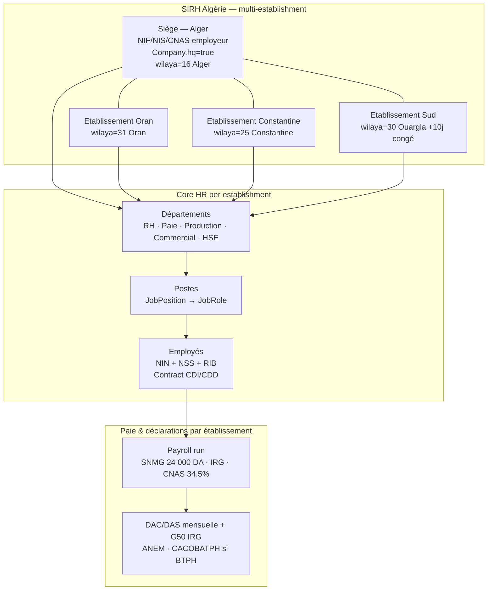
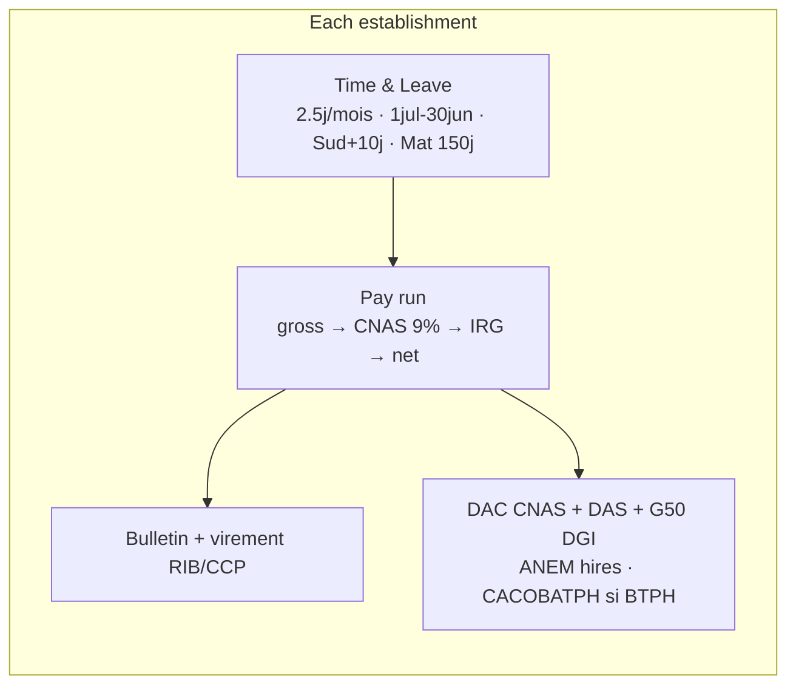

# 11 — Algeria Branch Graph Map (SIRH)

**Ponytail build:** one markdown file, zero code, zero deps. Reuses `05 §2.1`
domain model + live Horilla tables (`base_company`, `base_department`,
`base_jobposition`, `employee_workinformation`). For process detail see `03`;
for Horilla reuse see `06 §3`.

Refresh from live DB (web container up):

```bash
docker compose up -d db redis web
docker compose exec web python manage.py shell -c "
from base.models import Company, Department
for c in Company.objects.all().values('company','country','state','city','hq'):
    print(c)
for d in Department.objects.all().values('department','company_id__company')[:20]:
    print(d)
"
```

## 1. Branch org graph

`Company.company` = branch, `Company.country` = `Algérie`, `Company.state` = wilaya,
`Company.hq` = siège. Departments attach via `Department.company_id (M2M)`,
positions via `JobPosition.department_id + company_id (M2M)`, headcount via
`EmployeeWorkInformation.department_id / job_position_id`.



## 2. Horilla table map (no new model)

| Branch need (`05 §2.1`) | Horilla today | Fill-in |
|---|---|---|
| `legal_name_fr/ar`, NIF/NIS/CNAS/CASNOS | `base_company.company/address/country/state/city/zip` | Add DZ identifiers as company custom fields or `horilla_documents`, not a new app |
| `wilaya`, `collective_agreement`, `secteur` | `state` = wilaya, `address` = commune | Convention: `state` holds wilaya code+name (`16 — Alger`) |
| Establishment vs company | `Company` only (no establishment level, `06 §3`) | One `Company` row per establishment, `hq=true` on siège |
| Dept per branch | `Department.company_id M2M` | Reuse as-is |
| Poste per branch | `JobPosition.company_id M2M + department_id FK` | Reuse as-is |
| Affectation + manager | `EmployeeWorkInformation` | Reuse as-is |
| Payroll params | `payroll` components + DZ param tables (M1) | Effective-dated, never hard-coded |

## 3. Per-branch payroll routing



Checker rule (`05 §1.4`): paie, salary change, bank file, declarations = maker-checker (2 people) per establishment.

## 4. Seed checklist (smallest data that makes the graph real)

1. 1 `Company` with `country=Algérie, state=16 — Alger, hq=true` + NIF/NIS/CNAS numbers.
2. 1–3 `Company` rows for Oran / Constantine / Sud (same identifiers pattern, own wilaya).
3. `Department` rows linked via `company_id` M2M (RH, Paie, Production…).
4. `JobPosition` + `JobRole` per department, `EmployeeWorkInformation` per employee.
5. Re-run the refresh query above; paste output here to replace the placeholder names.
